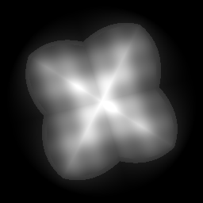

# 🏔️ Terraform

A real-time, browser-based low-poly terrain generator built with **Vite**, **TypeScript**, and **Three.js** (WebGL). All compute-heavy generation and erosion runs in a dedicated **Web Worker** using zero-copy `ArrayBuffer` transfers to keep the main thread locked at 60 fps.



## Features

### 1. Data Inputs & File Formats
- **Image Heightmap**: PNG, JPG, BMP, WebP — luminance (ITU-R BT.709) is converted to elevation.
- **Scattered Points (CSV)**: Auto-detects `x,y,z` or `lat,lon,elevation` headers; interpolates onto the grid using **Inverse-Distance Weighting (IDW)**.
- **Scattered Points (JSON)**: Array of `{x, y, z}` or `{lat, lon, elevation}` objects interpolated via IDW.
- **ESRI ASCII Grid (.asc)**: Full header parsing (`ncols`, `nrows`, `cellsize`, `NODATA_value`).
- **Procedural-Only**: Generate without any file upload.
- **Data ↔ Noise Blend**: A continuous slider to mix real-world elevation data with procedural noise.
- **Drag-and-Drop**: Drop files anywhere on the window, or click **Load File…** in the toolbar.
- **Sample Files**: Bundled in `/public/samples/` (`heightmap.png`, `points.csv`, `points.json`).

### 2. Procedural Noise
- **5 Algorithms**:
  - **Simplex fBm**: Smooth, natural multi-octave rolling hills.
  - **Perlin fBm**: Classic gradient noise fractal.
  - **Ridged Multifractal**: Sharp, jagged mountain ridges (`1 - |noise|`).
  - **Billow**: Billowy, soft cloud-like formations (`|noise|`).
  - **Voronoi / Cellular**: Distance-to-nearest-feature cells for volcanic/crater formations.
- **Fine Controls**: Seed, scale, octaves (1–10), lacunarity, persistence.
- **Shape Modifiers**: Height scale, redistribution power exponent, plateau/terrace step quantizer.

### 3. Post-Processing & Erosion
- **Smoothing Passes**: Box-blur iterations for gentle rolling hills.
- **Hydraulic Erosion**: Particle-based droplet simulation with momentum, dissolution capacity, sediment transport, and deposition.
- **Thermal Erosion**: Talus-angle redistribution for realistic scree slopes and cliffs.

### 4. Low-Poly Rendering & Shading
- **Non-Indexed Geometry**: Every triangle has unique vertices and flat face normals for a crisp, faceted low-poly aesthetic.
- **Mesh Resolution**: 16 to 256 segments (slider downsamples/upsamples on the fly).
- **Vertex Jitter**: Subtle randomized displacement of interior vertices for an organic, hand-crafted look.
- **Flat vs. Smooth Shading**: Toggle between faceted low-poly and smooth normals.
- **Height-Band + Slope Shading**: Per-face coloring based on height bands (sand, grass, forest, rock, snow) with an adjustable **Steepness Threshold** that forces rock coloring on sheer cliffs.
- **4 Palette Presets**:
  - 🏔️ **Alpine** (Sand, Grass, Forest, Rock, Snow)
  - 🏜️ **Desert** (Dunes, Sand, Dry Earth, Mesa, Peak)
  - 🌋 **Volcanic** (Basalt, Ash, Lava Rock, Magma, Lava)
  - ❄️ **Arctic** (Frozen Sea, Tundra, Ice, Glacier, Snow Peak)
- **Translucent Water Plane**: Adjustable water level and opacity.
- **Atmosphere & Sun**: Directional sunlight with azimuth, elevation, intensity sliders, soft PCF shadows, and distance fog.
- **OrbitControls**: Smooth damping, auto-rotate toggle, and reset camera button.

### 5. Analysis Views
- **Shaded**: Full low-poly lighting and palette coloring.
- **Slope Heatmap**: Color-coded by face steepness (Green 0° → Yellow 30° → Red 60°+).
- **Height Heatmap**: Blue (low) → Cyan → Green → Yellow → White (high).
- **Contour Lines**: Visual elevation contour intervals (adjustable spacing).
- **Wireframe Overlay**: Dark faceted polygon outlines over shaded mesh.
- **Interactive Readout**: Hovering over the terrain displays real-time normalized height, slope in degrees, and 3D world coordinates.
- **Dynamic Legend**: Canvas-drawn gradient legend that updates with the active view.

### 6. Export Options
- **Screenshot (PNG)**: 1×, 2×, or 4× resolution with solid or transparent background (`terraform-<seed>.png`).
- **Heightmap (PNG)**: Grayscale 8-bit heightfield image.
- **Mesh (OBJ)**: Non-indexed OBJ file with vertex positions, normals, and face indices.
- **Mesh (GLB)**: Binary glTF with embedded geometry and vertex colors.
- **Settings (JSON)**: Save and restore all generator parameters.

### 7. Keyboard Shortcuts
- `R`: Randomize seed
- `E`: Export PNG screenshot
- `A`: Toggle auto-rotation
- `Ctrl+Z` / `Ctrl+Y`: Undo / Redo parameter changes

---

## Getting Started

### Prerequisites
- Node.js 18+
- npm 9+

### Install & Run
```bash
# Clone and enter directory
git clone <repo-url>
cd terraform

# Install dependencies
npm install

# Start development server
npm run dev
```

Open [http://localhost:5173](http://localhost:5173) in your browser.

### Run Tests
```bash
npm test
```

### Production Build
```bash
npm run build
npm run preview
```

---

## Architecture & Pipeline

```
[Input: File / Seed]
        │
        ▼
[Web Worker: terrain.worker.ts]
   ├── 1. Generate Noise (Simplex / Perlin / Ridged / Billow / Voronoi)
   ├── 2. Resample & Blend Input Data (Float32Array)
   ├── 3. Shape Modifiers (Redistribution, Plateau Steps)
   ├── 4. Post-processing (Smoothing, Hydraulic, Thermal Erosion)
   └── 5. Normalize [0, 1] (Zero-copy transfer via ArrayBuffer)
        │
        ▼
[Main Thread: Three.js]
   ├── 1. Build Non-Indexed BufferGeometry (lowpoly.ts)
   ├── 2. Apply Per-Face Colours / Analysis Shading (terrain-colors.ts / analysis.ts)
   ├── 3. Update Scene (Water, Lighting, Shadows, Fog)
   └── 4. Render @ 60fps with OrbitControls & Hover Readout
```

---

## Tech Stack
- **Vite 6** — Ultra-fast bundler with native Web Worker ESM support
- **TypeScript 5** — Strict type safety across all interfaces
- **Three.js (r187)** — WebGL rendering, PCF shadows, ACESFilmic tone mapping, GLTFExporter
- **lil-gui** — Zero-dependency, lightweight parameter toolbar styled with a custom dark theme
- **Vitest** — Unit testing for loaders, heightfield arithmetic, IDW interpolation, and slope math

---

## License
MIT

